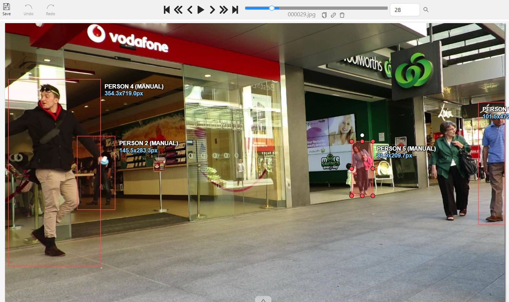
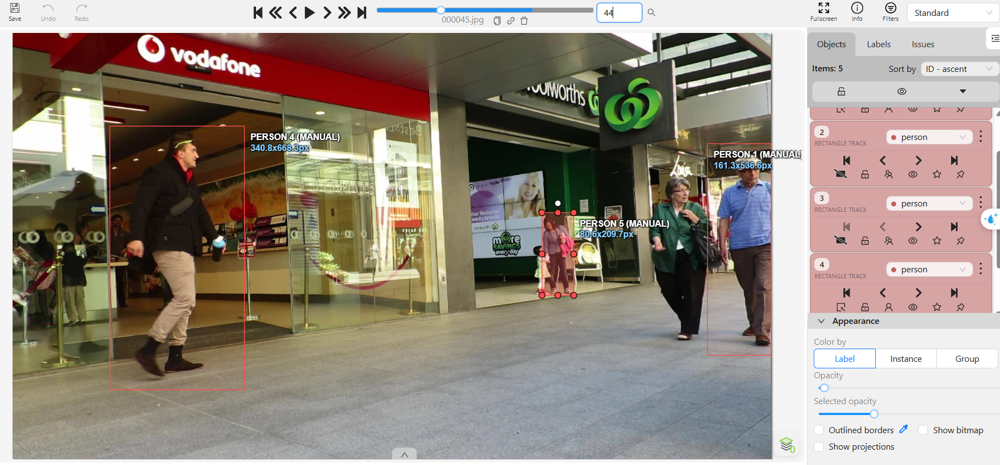
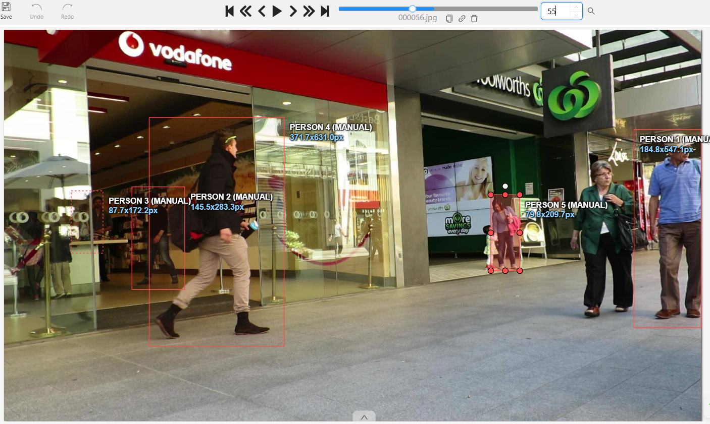

# Báo cáo cá nhân — DoanQuangMinh-2A202603228

Đoạn video: MOT17-09, 150 frame (frame 1–150), nguồn MOTChallenge, giấy phép CC BY-NC-SA 3.0.

## 0. Thông tin học viên

- Họ tên: Đoàn Quang Minh
- MSSV: 2A202603228
- Mã đề (A/B/C): C
- Email: 26ai.minhdq6@vinuni.edu.vn
- Link repository: https://github.com/doanquangminh14/K5-L2-DAY05-DoanQuangMinh-2A202603228-MOTTracking
- Giờ bắt đầu: 16:50
- Giờ kết thúc: 19:25

## 1. Xem trước đoạn video (CP0)

| Mã | Frame xuất hiện | Frame cuối thấy được | Rẽ / dừng / đổi tốc độ ở frame | Bị che ở frame | Ghi chú |
|---|---|---|---|---|---|
| P1 | 0 | 149 | Đi từ sâu trong cửa hàng ra phía cửa (~60–80), sau đó gần như đứng yên (~100–149) | 29–54 (bị P5 che, khuất hẳn 39–49) | Anh áo đen dài tay, quần jean, trong cửa hàng Vodafone |
| P2 | 49 | 149 | Đi ra phía cửa rồi đứng cạnh P1 (~80–149) | 49–66 (một phần) | Phụ nữ áo trắng cam trong cửa hàng, sau kính |
| P3 | 0 (chỉ thấy tay ở mép phải) | 149 | Đi thẳng về phía camera, box to dần liên tục | Không | Ông cụ áo polo xanh sọc, mũ be, đi cạnh bà áo xanh lá |
| P4 | 0 | 104 | Gần như đứng yên trước màn hình Woolworths | 98–104 một phần, khuất hẳn từ 105 | Phụ nữ áo jean, túi hồng, dắt bé gái |
| P5 | 0 | 135 | Đi ngang tiền cảnh từ trái sang phải, ra xa dần | 113–135 (khuất hẳn 120–126), khuất hẳn sau P3 từ 136 | Thanh niên áo khoác đen, khăn đỏ, quần kaki be |

## 2. Keyframe và thời gian (CP1, CP4)

Số keyframe lấy từ kết quả `src/check_submission.py`.

| Mã | Số keyframe | Keyframe ở frame | Số frame có mặt | Keyframe / 100 frame | Thời gian (phút) | Chỗ khó |
|---|---|---|---|---|---|---|
| P1 | 21 | 0, 10, 16, 29, 50, 52, 55, 63, 69, 77, 84, 85, 87, 90, 95, 97, 110, 119, 136, 143, 149 | 139 | 15,1 | ~12 | Bị P5 che: `occluded` 29–38, `outside` 39–49, `occluded` 50–54 |
| P2 | 22 | 49, 53, 55, 59, 62, 65, 67, 68, 69, 75, 78, 79, 80, 87, 88, 96, 106, 119, 136, 139, 141, 143 | 101 | 21,8 | ~12 | Ở sau kính, xuất hiện từ frame 49, bị che một phần 49–66 |
| P3 | 57 | 0, 1, 7, 8, 10, 11, 12, 13, 14, 15, 17, 23, 24, 29, 30, 34, 38, 40, 45, 59, 63, 65, 70, 72, 73, 78, 82, 85, 86, 91, 93, 98, 101, 102, 103, 104, 105, 106, 112, 116, 118, 124, 126, 127, 128, 130, 131, 132, 134, 135, 138, 142, 143, 144, 145, 147, 149 | 150 | 38,0 | ~32 | Đi vào từ mép phải, tiến về phía camera nên box to dần rất nhanh |
| P4 | 8 | 0, 12, 16, 20, 24, 38, 43, 98 | 105 | 7,6 | ~5 | Bị bà áo xanh và P3 che: `occluded` từ 98, `outside` 105–149 |
| P5 | 37 | 0, 2, 10, 12, 13, 16, 18, 19, 20, 21, 22, 38, 39, 40, 41, 43, 48, 55, 90, 101, 103, 104, 106, 107, 108, 109, 113, 114, 115, 116, 117, 118, 119, 127, 129, 131, 135 | 129 | 28,7 | ~21 | Tiền cảnh, sải chân rộng; khuất sau cặp vợ chồng 113–135, `outside` 120–126 và từ 136 |
| **Tổng** | **145** | | **624** | **23,2** | **82** | |

Tổng 82 phút là thời gian tôi làm trên job. Tôi không ghi giờ riêng cho từng người nên thời gian từng người là ước lượng, chia theo tỉ lệ số keyframe.

Keyframe / 100 frame của cả bài = tổng keyframe ÷ tổng số frame có mặt × 100 = 145 ÷ 624 × 100 = **23,2**

Bạn đặt keyframe nhiều nhất ở người nào? Vì sao (người đó rẽ, dừng, lại gần camera hay bị che)?

P3 có nhiều keyframe nhất: 57 cái. Tiếp theo là P5 với 37; P2 có 22, P1 có 21; P4 có 8.

Lý do là P3 đi thẳng về phía camera, nên box phình to nhanh và không đều:

- **Kích thước thay đổi rất mạnh.** Chiều cao box của P3 tăng từ khoảng 300 px ở đầu video lên gần 1.000 px ở cuối, gấp hơn 3 lần. Những người khác thay đổi ít hơn nhiều; ví dụ P1 chỉ từ 283 lên 388 px.
- **Phình to không theo đường thẳng.** Khi người tiến lại gần, kích thước trên ảnh tăng theo tỉ lệ nghịch với khoảng cách: càng gần camera thì box càng to nhanh. CVAT nội suy tuyến tính giữa hai keyframe, nên với đoạn dài thì box bị hụt so với người thật, tôi phải thêm keyframe dày mới bám được. Vì vậy keyframe của P3 dồn nhiều ở cuối video (101–106, 124–149), lúc ông ở gần camera nhất.
- **Đầu video ông bị cắt ở mép phải.** Ở frame 0, box bắt đầu sát cạnh phải ảnh. Khi ông bước dần vào khung, chiều rộng box thay đổi theo từng frame, nên đoạn 0–17 cũng có nhiều keyframe sát nhau.

## 3. Đoạn bị che (CP2)

Người bị che: `P1` (track #2 trên CVAT, ID 2 trong `gt.txt`), bị P5 đi ngang tiền cảnh che.

| Mốc | Frame |
|---|---:|
| Bắt đầu bị che một phần (bật `occluded`) | 29 |
| Mất hẳn (bật `outside`) | 39 |
| Hiện lại (tắt `outside`) | 50 |
| Thấy rõ trở lại (tắt `occluded`) | 55 |

- Thời gian khuất hẳn: 11 frame (39–49) = 0,37 giây.
- Quyết định: giữ cùng ID (track #2 suốt đoạn che).
- Lý do:

1. **Khuất bao lâu:** 11 frame (39–49), nhỏ hơn nhiều so với ngưỡng 60 frame của lớp (chưa bằng 1/5). Theo `docs/GUIDELINE.md` mục 3, khuất ≤ 60 frame và chắc chắn cùng người thì giữ cùng track.
2. **Ngoại hình:** người trước đoạn che (frame 28) và sau khi hiện lại (frame 55) giống nhau: áo đen dài tay, quần jean xanh đậm, tóc ngắn tối màu, đeo kính, cùng đứng sau quầy trong cửa hàng Vodafone.
3. **Hướng đi và tốc độ** (tâm box theo chiều ngang):

   | Đoạn | Tâm box x | Tốc độ |
   |---|---|---|
   | Frame 0 → 16 | 316 → 349 | ~2 px/frame, sang phải |
   | Frame 29 → 50 (qua đoạn khuất) | 349 → 395 | ~2,2 px/frame, sang phải |
   | Frame 50 → 69 (sau khi hiện lại) | 395 → 473 | ~4 px/frame, sang phải |

   Hướng đi giữ nguyên (sang phải), độ cao tâm box gần như không đổi (574–582 px). Người hiện ra ở frame 50 nằm đúng chỗ tôi đoán nếu P1 đi tiếp qua đoạn khuất. Sau khi hiện lại P1 đi nhanh hơn một chút (~4 so với ~2 px/frame), hợp lý vì anh ấy bắt đầu bước ra phía cửa.

Ảnh chụp màn hình (nguồn ảnh: MOT17, MOTChallenge (Milan et al., 2016)):





## 4. Tự review ID (CP3)

| Frame | Mã người | Loại lỗi | Mô tả một câu | Phát hiện ở lượt | Đã sửa? |
|---:|---|---|---|---|---|
| 0 | P4 | `lost` | Người vẫn trong khung nhưng không có box | Tự kiểm bằng script + ảnh | Có (vẽ box ở frame 0 rồi Merge vào track #5) |
| 92–97 | P4 | `flag` | Thừa cờ `occluded` khi P4 vẫn thấy rõ | Tự kiểm bằng script + ảnh | Có (dời `occluded` sang frame 98) |
| 105–149 | P4 | `flag` | Thiếu `outside`, box đứng yên và đè lên P3 | Tự kiểm bằng script + ảnh | Có (bật `outside` từ frame 105) |

Ngoài ra (không thuộc 7 mã lỗi): P5 ban đầu có 78 keyframe (60 / 100 frame, script cảnh báo > 50). Tôi bỏ keyframe ở các đoạn đi thẳng, còn 37 (28,7 / 100), tua lại không thấy box trôi.

Tổng hợp số lỗi theo loại:

| `id_switch` | `fragmentation` | `lost` | `merge` | `false_track` | `drift` | `flag` |
|---:|---:|---:|---:|---:|---:|---:|
| 0 | 0 | 1 | 0 | 0 | 0 | 2 |

Lỗi nào chỉ lượt 2 (theo cảnh) mới thấy, lượt 1 (theo người) không thấy? Vì sao?

Lượt 1 đi theo từng người, nên tôi chỉ để ý box có bám đúng người đó không. Lượt 2 nhìn cả cảnh, mới thấy được chuyện hai box đè lên nhau.

## 5. File xuất và kết quả tự kiểm (CP4)

| Kiểm tra | Kết quả |
|---|---|
| Tên file MOT 1.1 | `src/exports/DoanQuangMinh_mot.zip` |
| Tên file CVAT for video 1.1 | `src/exports/DoanQuangMinh_cvat_video.zip` |
| Số track ID khác nhau trong `gt/gt.txt` (phải là 5) | 5 |
| Frame `outside` không có dòng trong `gt.txt` (đúng / sai) | Đúng: ID 2 (P1) không có dòng nào ở `frame_id` 40–50 (CVAT 39–49) |
| Job đã completed trên CVAT máy cá nhân | Có |

Kết quả `src/check_submission.py`:

```text
=== File MOT 1.1: DoanQuangMinh_mot.zip ===
  Số track ID: 5   |   Tổng số box: 624
  [OK]        Đúng 5 track ID.

  Track | Frame có mặt | Số frame | Đoạn vắng (outside)
      1 |   0–149      |      150 | -
      2 |   0–149      |      139 | 39–49
      3 |   0–135      |      129 | 120–126
      4 |   0–104      |      105 | -
      5 |  49–149      |      101 | -

=== File CVAT for video 1.1: DoanQuangMinh_cvat_video.zip ===
  Track | Nhãn   | Frame thấy | Keyframe | KF/100 frame | Frame occluded | Lần bật outside
      0 | person |        150 |       57 |         38.0 |              0 |               0
      1 | person |        139 |       21 |         15.1 |             15 |               1
      2 | person |        101 |       22 |         21.8 |             18 |               0
      3 | person |        129 |       37 |         28.7 |             16 |               2
      4 | person |        105 |        8 |          7.6 |              7 |               1
  Tổng: 145 keyframe / 624 frame có mặt = 23.2 keyframe / 100 frame
  [OK]        Đọc được 5 track từ annotations.xml.

=== Tóm tắt ===
  Lỗi: 0   |   Cảnh báo: 0
  Đạt. Dán phần tóm tắt này vào báo cáo mục 5.
```

## 6. Ba câu kết

1. Nếu được gán lại, bạn sẽ đặt keyframe khác ở đâu? Vì sao?

   P5 lúc đầu có 78 keyframe, đặt gần như từng frame ở các đoạn đi thẳng. Sau đó tôi xoá bớt còn 37 mà box vẫn bám người. Nếu gán lại, ngay từ đầu tôi sẽ:

   - Tua một lượt trước khi gán, xem người đó đi từ đâu tới đâu, chỗ nào rẽ, dừng, bị che, và ghi nhanh vài frame quan trọng.
   - Đặt keyframe ở các frame quan trọng đó trước: đầu, cuối, chỗ đổi hướng hoặc tốc độ, quanh đoạn che.
   - Với đoạn đi thẳng dài, chỉ thêm một keyframe ở giữa nếu cần; thường cách nhau 15–30 frame là đủ.
   - Tua `F` kiểm tra. Chỗ nào box lệch khỏi người rõ rệt (ví dụ hụt mất đầu hoặc chân) thì thêm đúng một keyframe ở frame lệch nhiều nhất, rồi tua lại đoạn đó.
   - Dừng khi box bám đủ sát, không cần khít từng pixel.

2. Có chỗ nào bạn không chắc "cùng ID hay ID mới"? Bạn đã quyết định và ghi chú thế nào?

   Chỗ tôi phân vân là P5: khuất 120–126 sau cặp vợ chồng, sau đó hiện lại một phần ở 127–135, xen giữa bà áo xanh và P3, lúc đó chỉ thấy một phần người. Tôi kiểm theo các căn cứ sau:

   - **Chuyển động:** trước khi khuất, tâm box đi sang phải từ 1246 (frame 110) đến 1299 (frame 119), khoảng 6 px/frame. Nếu giữ tốc độ đó qua đoạn khuất, đến frame 127 tâm sẽ ở khoảng 1347; thực tế là 1371, cùng hướng, chỉ nhanh hơn một chút. Khuất chỉ 7 frame (120–126), rất ngắn so với ngưỡng 60.
   - **Ngoại hình:** người lộ ra ở khe giữa bà áo xanh và P3 mặc áo đen, quần be, giày tối màu, giống P5 trước khi khuất. Quần của P3 màu nâu xám, khác rõ.
   - **Loại trừ P4:** P4 là phụ nữ mặc áo khoác jean xanh, đeo túi hồng, đi cùng bé gái; người ở khe mặc áo đen, quần be và đi một mình.
   - **Frame 136:** P5 đã bị người đàn ông đội mũ (P3) che mất nên tôi bật `outside`.

   Quyết định: giữ cùng ID cho P5, bật `occluded` ở 127–135 và `outside` từ 136.

3. Một lỗi ID trong job của bạn (nếu không còn sót, chọn lỗi đã sửa) có thể làm xe tự lái dự đoán sai chuyển động của người đó như thế nào? Lỗi đó ảnh hưởng MOTA hay IDF1 nhiều hơn?

   Xe dự đoán người đi bộ sẽ đi đâu dựa vào lịch sử vị trí của cùng một ID: vài frame trước người ở đâu, đi hướng nào, nhanh bao nhiêu. Khi ID bị lỗi, lịch sử đó sai theo hai kiểu:

   - Hai người bị gộp chung một ID: chuỗi vị trí nhảy từ người A sang người B. Xe tính ra một vận tốc vô lý, ví dụ người "dịch chuyển" vài mét trong một frame, hoặc đổi hướng đột ngột, nên dự đoán quỹ đạo đi chệch hẳn.
   - Một người bị tách thành ID mới: xe mất toàn bộ lịch sử của người đó và coi như một người vừa xuất hiện, chưa biết vận tốc. Trong vài frame đầu, xe không đoán được người đó đang đi về đâu, nên phản ứng chậm hơn.

   Với lỗi đổi ID, IDF1 bị ảnh hưởng nhiều hơn MOTA. MOTA tính một lần đổi ID là một IDSW, chỉ trừ ở đúng frame xảy ra, nên vài IDSW chỉ làm MOTA giảm rất ít. Còn IDF1 đo mỗi ID có đi đúng một người suốt video không; khi ID nhảy sang người khác, toàn bộ các frame sau đó bị tính là ghép sai, nên một lần đổi ID ở giữa video có thể kéo IDF1 xuống rất mạnh.

   Trong job của tôi không có `id_switch`; lỗi gần nhất (đã sửa) là P4 ở frame 105–149. Box của P4 đứng yên nên vận tốc tính ra bằng 0, tức xe hiểu là P4 đang đứng im một chỗ, trong khi P4 thực ra đã khuất. Box đó lại đè lên P3, một người khác đang đi, nên mô hình học từ nhãn này dễ lẫn vị trí của hai người.

   Lỗi này không phải đổi ID mà là FP: 45 frame có box không khớp người nào. Lấy tổng số box của 5 track làm GT (150 + 139 + 129 + 105 + 101 = 624):

   - MOTA: mỗi FP trừ trực tiếp vào tử số, 45 / 624 ≈ 7 điểm %.
   - IDF1: 45 FP thành 45 IDFP, chỉ cộng vào mẫu số cạnh 2·IDTP (≈ 1248). 1248 / (1248 + 45) ≈ 0,965, tức giảm khoảng 3,5 điểm %.

   Trong MOTA, mỗi FP bị tính đủ 1 phần trên tổng GT; trong IDF1, phần đúng được nhân 2 nên mỗi FP chỉ "nặng" khoảng một nửa. Vì vậy với lỗi P4 (FP), MOTA bị ảnh hưởng nặng hơn; IDF1 chỉ bị nặng hơn khi lỗi khiến một ID bị gán nhầm sang người khác trong thời gian dài.

## Bonus (nếu làm)

Không làm bonus.

## 7. Tài liệu tham khảo và công cụ AI đã dùng

- Tài liệu của lab: `docs/GUIDELINE.md`, `docs/CVAT_CHEATSHEET.md`, `docs/MOT_FORMAT.md`, `CHECKPOINTS.md`.
- Dữ liệu: MOT17-09, MOTChallenge (Milan et al., 2016), giấy phép CC BY-NC-SA 3.0.
- Công cụ AI: tôi dùng Claude Code để cài môi trường, chạy `src/check_submission.py` và giải thích kết quả, vẽ box từ file xuất lên ảnh gốc để tự kiểm, đối chiếu số liệu và sửa câu chữ trong báo cáo; có tham khảo thêm trợ lý AI dạng chat để tra cách so sánh MOTA / IDF1. Box và track ID do tôi tự gán trên CVAT; các quyết định ID và nhận xét trong mục 4, mục 6 là của tôi.
